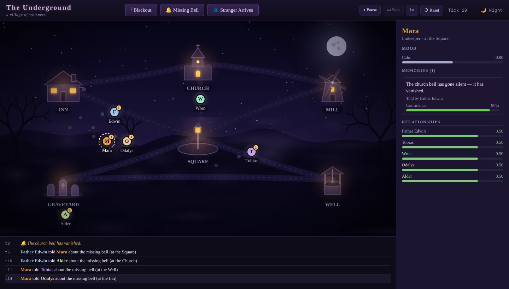
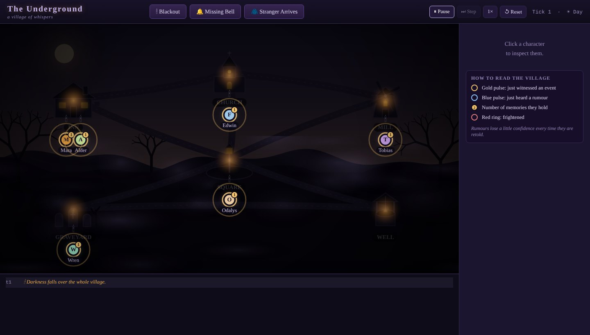
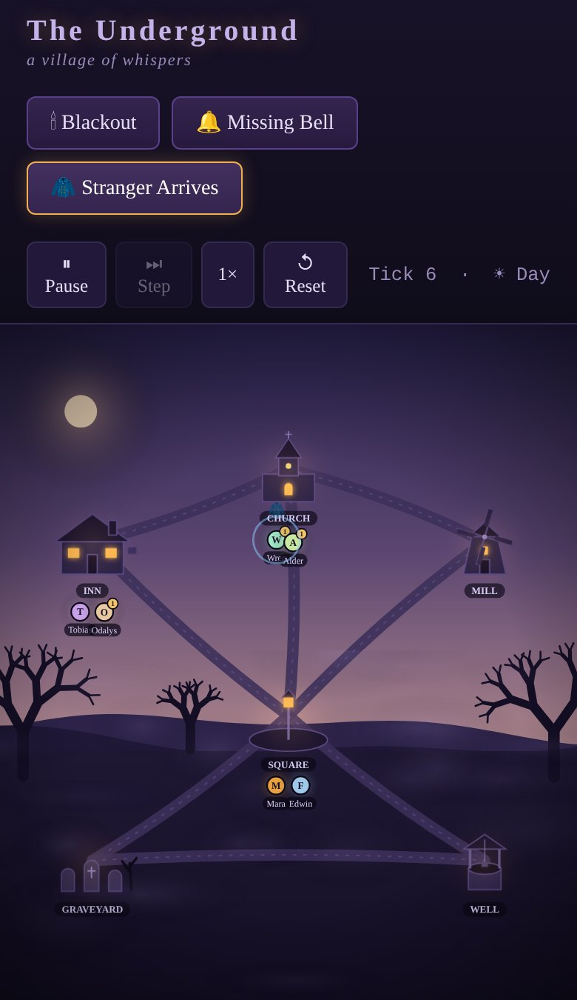
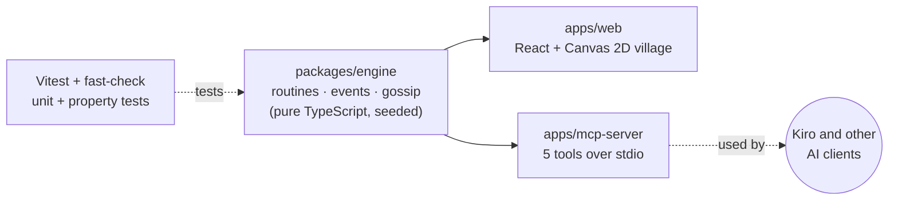

<div align="center">



### A haunted village where news spreads like gossip

[](https://kiroween.devpost.com)
[](https://kiroween.devpost.com)
[](https://kiro.dev)


## 👻 [**Enter the village → the-underground-web-smoky.vercel.app**](https://the-underground-web-smoky.vercel.app)

<!-- Demo video: add your YouTube link here, for example: ### 🎬 [Watch the 3-minute demo](https://youtu.be/...) -->

</div>

---

## What is this?

Six villagers wander a haunted village on daily routines. Press a button and something
strange happens: the church bell vanishes, the lights go out, a hooded stranger appears.
The villagers who see it become witnesses. Everyone else only hears about it, one
whispered retelling at a time, and **every retelling makes the story a little less certain.**

Click any villager to read their mood, their memories (who told them, and how sure they
are) and who they trust. It is a small, playful way to *watch* how a rumour travels.

<p align="center">
  
</p>

## Try it in 30 seconds

1. Open the **[live demo](https://the-underground-web-smoky.vercel.app)**.
2. Press **🔔 Missing Bell**.
3. Watch the **gold pulse** (just witnessed it) and the **blue pulse** (just heard a rumour).
4. Click **Mara** (or anyone) and open their memories. See how confident they are.
5. Try **Pause / Step / 2× / Reset**, or add `?seed=7` to the address for a different village.

## How a rumour spreads

<p align="center">
  
</p>

- **Routines.** Each villager has a day and a night route, and the night watchman patrols every
  place. Routines depend only on the tick, so there is no hidden randomness.
- **Witnesses.** Whoever is standing at the scene when an event happens becomes a witness
  with 100% confidence and a mood change.
- **Gossip.** Each tick, a villager may tell a trusted listener in the same place about news
  they have not heard. The chance depends on how gossipy the speaker is and how much they
  trust the listener. News travels one hop per tick.
- **Fading certainty.** Every retelling multiplies confidence by 0.9.
- **Seeded.** All randomness comes from a seeded generator, so the same seed always
  produces the same village history.

<table>
  <tr>
    <td width="50%"></td>
    <td width="50%"></td>
  </tr>
  <tr>
    <td align="center"><sub>Blackout: only the lanterns still glow</sub></td>
    <td align="center"><sub>Works on a phone too</sub></td>
  </tr>
</table>

## Architecture



The engine is the single source of truth. The web app and the MCP server both import it,
so there is exactly one set of rules.

## Run it locally

Requires Node.js 20 or newer.

```bash
npm install
npm run dev        # builds the engine, then starts the village at http://localhost:5173
npm test           # engine + MCP server tests (63)
npm run build      # builds everything (this is also the deploy build)
```

## MCP server

`apps/mcp-server` lets any MCP client poke the village over stdio:

| Tool | What it does |
| --- | --- |
| `list_characters` | Names, jobs, places and moods of everyone |
| `get_character_memory` | What one villager knows, who told them, and how sure they are |
| `trigger_event` | Queue a Blackout, Missing Bell or Stranger Arrives |
| `advance_time` | Run some ticks and return the whispers they produced |
| `get_world_summary` | A short story of the village right now |

It runs its own engine instance, so it is not linked to the browser view.

```bash
npm run build
node apps/mcp-server/dist/index.js
```

<details>
<summary>Kiro workspace config (<code>.kiro/settings/mcp.json</code>)</summary>

On Linux or macOS:

```json
{
  "mcpServers": {
    "underground-world": {
      "command": "node",
      "args": ["apps/mcp-server/dist/index.js"]
    }
  }
}
```

If Kiro runs on Windows but the dependencies were installed inside WSL, launch through WSL
(adjust the paths to your machine):

```json
{
  "mcpServers": {
    "underground-world": {
      "command": "wsl",
      "args": ["/home/<user>/.nvm/versions/node/v20.20.2/bin/node",
               "/mnt/d/underground/apps/mcp-server/dist/index.js"]
    }
  }
}
```

</details>

## Testing

- **Engine:** unit tests plus property-based tests (fast-check) for the rules that must always
  hold: news never teleports, a seed always gives the same history, confidence never rises when
  a rumour is retold, moods and trust stay in range, nobody holds two memories of one event,
  and everyone is always somewhere valid.
- **Routines:** every event has a witness at day and night start times, and news reaches
  several villagers on average.
- **MCP server:** all five tools, including invalid input.

## Deploying

A static site. On Vercel or Netlify, import the repo and use build command `npm run build` and
output directory `apps/web/dist` (`vercel.json` already contains these).

## Built with Kiro

The project was planned and built in Kiro: steering docs and specs in [`.kiro/`](.kiro), the
engine and its tests, the first version of the web app, and the MCP server. Kiro's credits ran
out before the final polish, so the remaining work (daily routines, the redesigned village
canvas, controls, this README and the deployment config) was finished outside Kiro. Everything
done outside Kiro is listed in [`docs/manual-changes.md`](docs/manual-changes.md), and Kiro's own
account of its work is in [`docs/kiro-log.md`](docs/kiro-log.md).

## License

MIT. See [LICENSE](LICENSE).
